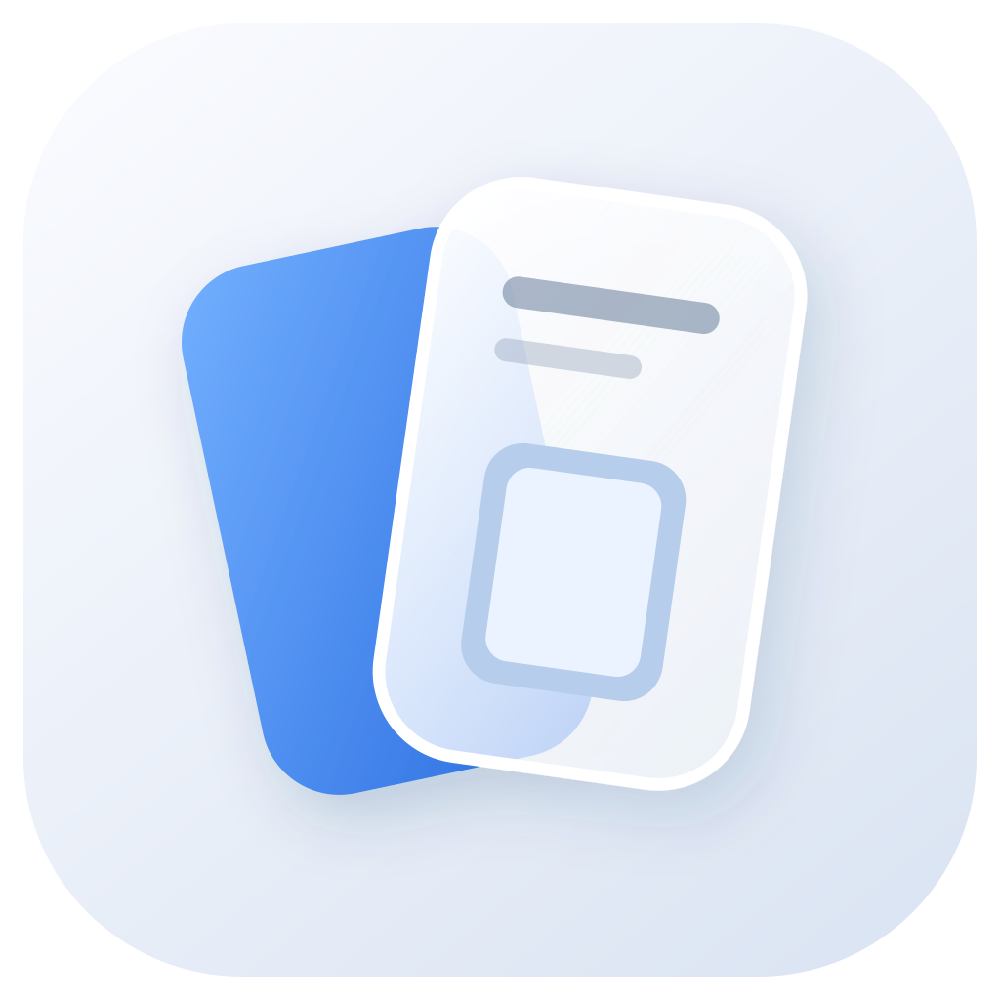
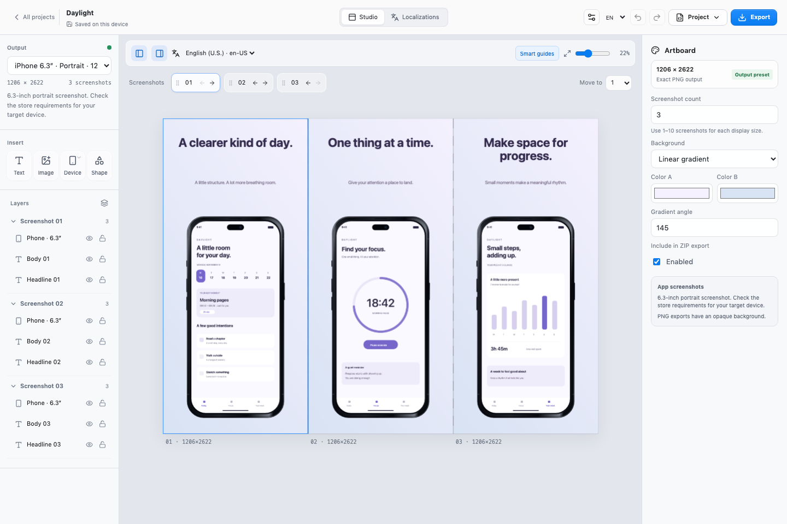
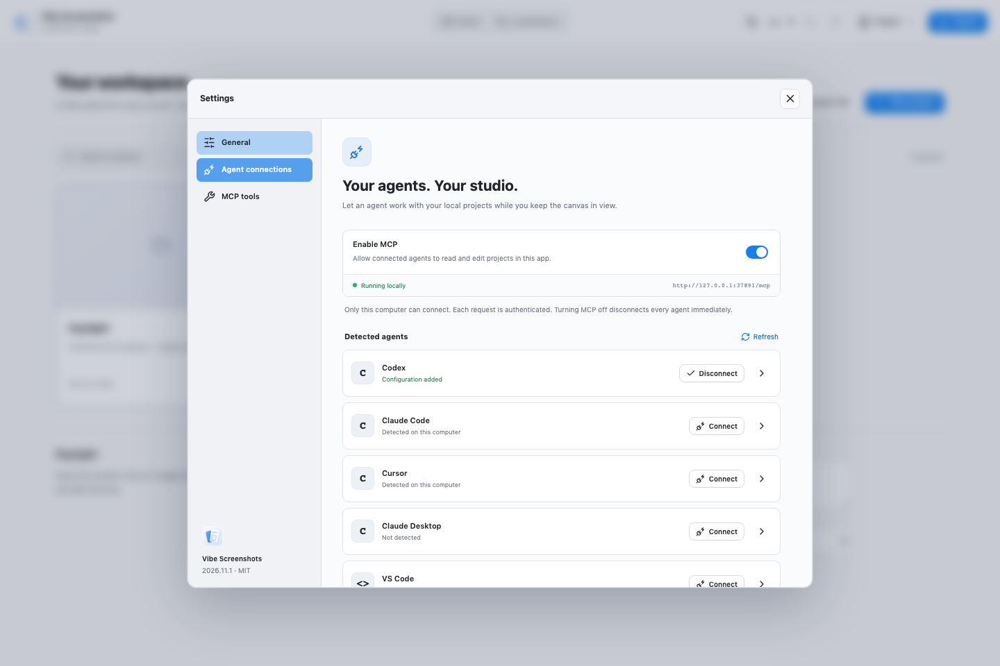

<p align="center"></p>
<h1 align="center">Vibe Screenshots</h1>
<p align="center">A local studio for your app’s next first impression.</p>
<p align="center"><a href="https://github.com/furkangonel/vibe_screenshot/releases">Download</a> · <a href="README.tr.md">Türkçe</a> · <a href="docs/MCP.md">MCP guide</a> · <a href="LICENSE">MIT license</a></p>

Compose app screenshots, adapt the copy across languages, and export exact-size PNGs for the App Store and Google Play. Work in a browser or use the desktop app for macOS, Windows, and Linux. Projects and uploaded images stay on your device. No account or cloud service is required.



_Every screen shown here was drawn for the fictional Daylight demo. No personal projects or captured app screens are included._

## A practical place to work

- **Projects, with a way home.** Create, search, duplicate, and reopen projects. Return to All projects from the studio without closing your work.
- **Space when you need it.** Toggle the layers and inspector independently, or hide both to focus on the canvas. Sidebar and precision preferences are remembered.
- **Precise placement.** Align edges and centers, match sizes, and balance equal gaps. Adjust the snapping distance, align across screenshots, or hold Option / Alt to move freely. Guides never appear in exports.
- **One composition, many languages.** Edit a 28-language copy matrix, with per-language text layout and device screenshots. English and Turkish interface languages are separate from content languages.
- **Devices that fit the layout.** Phone, tablet, Android, and foldable concept frames, with orientation, non-destructive cropping, color finishes, and screen positioning.
- **Exact output.** Export one opaque PNG or a ZIP of selected canvases and languages, including a manifest. Import and export portable project files with embedded images.
- **Local agent control.** Enable MCP in Settings, review detected clients, and add their configuration from the app. Agents use the same project validation, renderer, and save flow as the editor.

<details>
<summary>Screenshot presets</summary>

| Target             | Portrait    | Landscape   |
| ------------------ | ----------- | ----------- |
| iPhone 6.3″        | 1206 × 2622 | 2622 × 1206 |
| iPhone 6.9″        | 1320 × 2868 | —           |
| iPad 13″           | 2064 × 2752 | 2752 × 2064 |
| Android phone      | 1080 × 1920 | 1920 × 1080 |
| Android tablet 7″  | 1440 × 2560 | 2560 × 1440 |
| Android tablet 10″ | 2160 × 3840 | 3840 × 2160 |
| Custom foldable    | 1398 × 2034 | —           |

Creative presets are also included at 3840 × 1646, 3840 × 2560, and 5244 × 2950. Android presets support up to eight screenshots; App Store screenshot presets support up to ten. Existing projects add Android canvases on demand from the Output picker.

Android resolutions are working presets, not mandatory device-specific sizes. Generic device names and internal IDs do not certify real hardware. Check [Apple’s screenshot specifications](https://developer.apple.com/help/app-store-connect/reference/app-information/screenshot-specifications/) and [Google Play’s preview asset guidelines](https://support.google.com/googleplay/android-developer/answer/9866151) before submitting.
</details>

## Download

Get an installer from [Releases](https://github.com/furkangonel/vibe_screenshot/releases):

| Platform             | File                        |
| -------------------- | --------------------------- |
| macOS, Apple silicon | `*-mac-arm64.dmg` or `.zip` |
| macOS, Intel         | `*-mac-x64.dmg` or `.zip`   |
| Windows, x64         | `*-win-x64.exe`             |
| Linux, x64           | `*-linux-x64.AppImage`      |

Release installers are currently **unsigned and not notarized**. Platform security checks may require manual approval. The app has no automatic updater; replace the installed app with a later release. Project data lives separately from the application bundle. Back up portable project files before changing devices or clearing app data.

## Connect a local agent



_The connection screenshot illustrates the setup states; it does not show a personal agent configuration._

1. Open the desktop app and choose **Settings → Agent connections**.
2. Turn on **Enable MCP**. It is off by default.
3. Review a client’s configuration, then choose **Connect**. Supported clients are Codex, Claude Code, Claude Desktop, Cursor, and VS Code.
4. Restart or reload that client’s MCP connections. Keep Vibe Screenshots open.

The app detects known local client folders and application bundles; detection does not prove that a client is running. Configuration changes preserve unrelated settings and back up existing files. An unmanaged entry with the same server name is never silently replaced. The stdio bridge uses the desktop app’s bundled runtime, so end users do not need Node.js.

MCP provides 34 tools for projects, canvases, layers, localized copy, devices, preview rendering, history, and PNG/ZIP/project export, plus a reference resource and a composition prompt. The local HTTP endpoint binds only to `127.0.0.1`, requires a local bearer token, and rejects browser origins. It exposes no shell execution or arbitrary filesystem API. Disabling MCP closes the listener; connected agents cannot call tools until it is enabled again.

See [the MCP guide](docs/MCP.md) for the catalog, connection format, export location, and troubleshooting. MCP is a desktop feature; the browser editor works independently.

## Run from source

Use Node.js **22.13 or later** and npm. The tested version is recorded in `.nvmrc`.

```sh
git clone https://github.com/furkangonel/vibe_screenshot.git
cd vibe_screenshot
npm ci
npm run dev
```

For desktop development:

```sh
npm run desktop        # build and launch Electron
npm run desktop:pack   # unpacked app in release/
npm run desktop:dist   # installers for the current OS
```

For UI hot reload, run `npm run dev -- --port 5173 --strictPort` and `npm run desktop:dev` in separate terminals. The development server must remain on loopback.

Browser storage is tied to its hostname, port, and browser profile. Browser and desktop libraries are separate; transfer projects using `.vibescreens.json` files.

## Keyboard shortcuts

| Action                         | macOS           | Windows / Linux           |
| ------------------------------ | --------------- | ------------------------- |
| All projects                   | `⌘ ⇧ H`         | `Ctrl Shift H`            |
| Settings                       | `⌘ ,`           | `Ctrl ,`                  |
| Toggle layers                  | `⌘ 1`           | `Ctrl 1`                  |
| Toggle inspector               | `⌘ 2`           | `Ctrl 2`                  |
| Focus canvas                   | `⌘ \`           | `Ctrl \`                  |
| Undo / redo                    | `⌘ Z` / `⌘ ⇧ Z` | `Ctrl Z` / `Ctrl Shift Z` |
| Bypass snapping while dragging | `Option`        | `Alt`                     |

## Verify and contribute

```sh
npm run check                    # lint, types, unit/protocol tests, assets, build
npx playwright install chromium
npm run test:e2e                 # browser regression tests
npm run test:desktop             # sandbox, assets and save/relaunch
npm run test:mcp                 # desktop MCP and isolated client configuration tests
```

MCP tests bind loopback ports. Desktop tests use isolated profiles; they do not edit your project library or real agent configurations. Linux desktop tests need a display server; CI uses Xvfb.

See [CONTRIBUTING.md](CONTRIBUTING.md), [architecture](docs/ARCHITECTURE.md), [release instructions](docs/RELEASING.md), and [security policy](SECURITY.md).

## Data and artwork

Local saves include uploaded images and are not encrypted or synced by this app. Clearing browser data or deleting the desktop profile removes those saves. Export portable project files for backups. Disabling “Save on this device” removes that project’s stored copy after confirmation and keeps its session open.

The repository and public releases use original SVG device illustrations. The logo, demo screens, and documentation images are included under [MIT](LICENSE). An optional private artwork pack may be used in local builds; it is excluded from this repository and public release builds, and keeps its own licensing terms. See [asset attribution](public/assets/devices/ATTRIBUTION.md) and [third-party notices](THIRD_PARTY_NOTICES.md).
