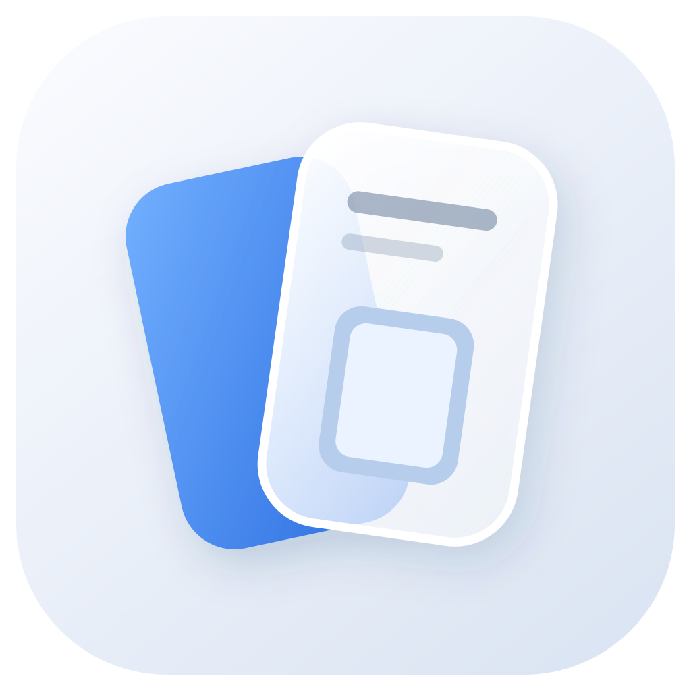
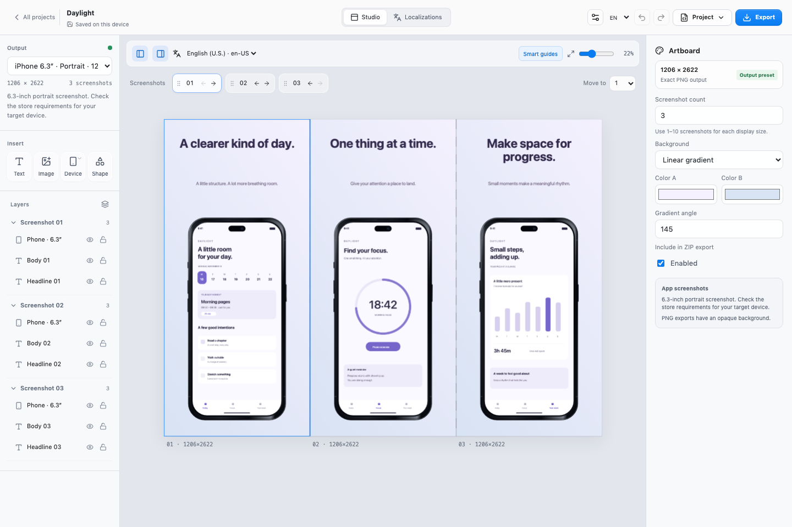
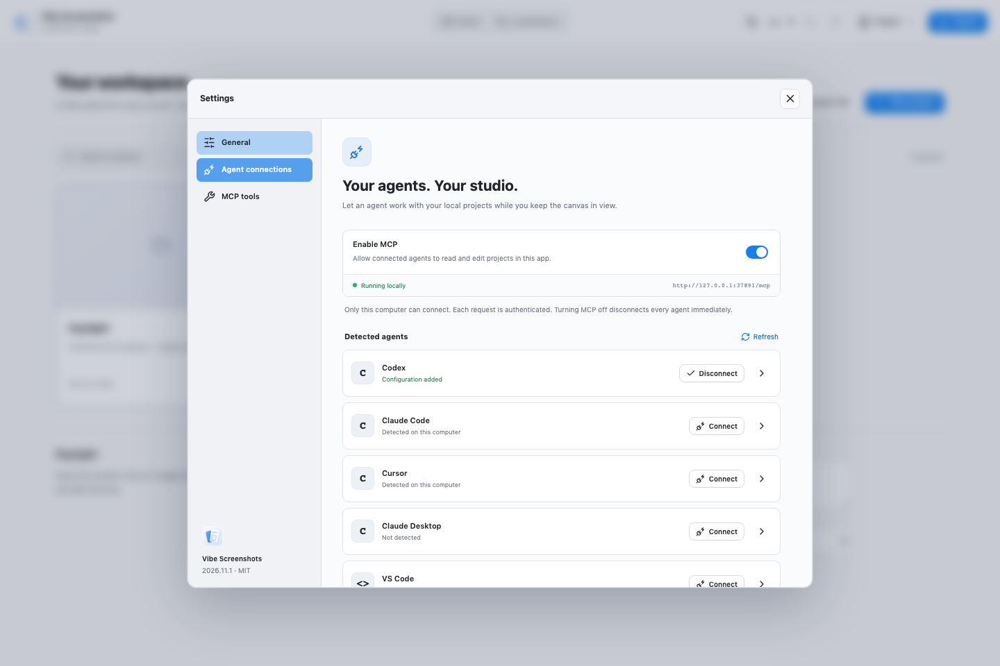

<p align="center"></p>
<h1 align="center">Vibe Screenshots</h1>
<p align="center">Uygulamanın ilk izlenimini hazırlayabileceğin yerel stüdyo.</p>
<p align="center"><a href="https://github.com/furkangonel/vibe_screenshot/releases">İndir</a> · <a href="README.md">English</a> · <a href="docs/MCP.md">MCP rehberi</a> · <a href="LICENSE">MIT lisansı</a></p>

App Store ve Google Play için görseller tasarla, metinlerini farklı dillere uyarla ve tam boyutlu PNG dosyaları oluştur. Tarayıcıda veya macOS, Windows ve Linux masaüstü uygulamasında çalışır. Projeler ve yüklediğin görseller cihazında kalır; hesap ya da bulut servisi gerekmez.



_Buradaki tüm ekranlar, dokümantasyon için hazırlanan kurgusal Daylight uygulamasına aittir. Kişisel projeler ve gerçek uygulamalardan alınmış ekran görüntüleri kullanılmamıştır._

## Stüdyoda neler var?

- Proje oluşturma, arama, çoğaltma ve tekrar açma. Düzenleyiciden **Tüm projeler** düğmesiyle ana sayfaya dönme.
- Bağımsız açılıp kapanan katman ve özellik panelleri. Hatırlanan panel tercihleri ve tuvale odaklanma kısayolu.
- Kenar ve merkez hizalama, boyut eşleştirme ve eşit aralık kılavuzları. Ayarlanabilir yakalama mesafesi ve görseller arası hizalama. Serbest taşımak için Option / Alt.
- 28 içerik dili; dile özel metin konumu ve cihaz ekranı. İçerik dilinden bağımsız Türkçe / İngilizce arayüz.
- Telefon, tablet, Android ve katlanabilir konsept çerçeveleri; renk, yön, ekran yerleşimi ve geri alınabilen kırpma.
- Tek PNG, seçili diller ve boyutlar için ZIP ve görselleri içinde taşıyan proje dosyaları.
- Masaüstünde MCP ve yerel agent bağlantıları. Proje, katman, çeviri, önizleme ve dışa aktarma için 34 araç.

Android dikey boyutları telefon için **1080 × 1920**, 7 inç tablet için **1440 × 2560**, 10 inç tablet için **2160 × 3840**. Yatay karşılıkları da var. Mevcut projelere Çıktı menüsünden yeni Android tuvali eklenebilir. Tüm boyutlar [İngilizce README’de](README.md#screenshot-presets) listelenir. Mağaza kurallarını göndermeden önce kontrol et; Android boyutları çalışma ön ayarlarıdır.

## İndir ve kullan

[Releases](https://github.com/furkangonel/vibe_screenshot/releases) sayfasından macOS Apple silicon / Intel için DMG veya ZIP, Windows x64 için EXE, Linux x64 için AppImage indirebilirsin.

Yayınlanan paketler şu an **imzasızdır; macOS noter onayı yoktur**. İşletim sistemi manuel onay isteyebilir. Otomatik güncelleyici bulunmaz. Uygulamayı yeni sürümle değiştirebilirsin; proje verileri uygulama paketinden ayrı tutulur. Verileri silmeden veya cihaz değiştirmeden önce proje dosyalarını yedekle.

## Agent bağla



_Bağlantı görseli örnek durumları gösterir; kişisel agent yapılandırması içermez._

1. Masaüstü uygulamasında **Ayarlar → Agent bağlantıları** bölümünü aç.
2. **MCP’yi aç** seçeneğini etkinleştir. Varsayılan olarak kapalıdır.
3. Codex, Claude Code, Claude Desktop, Cursor veya VS Code için gösterilen yapılandırmayı inceleyip **Bağla** düğmesini kullan.
4. Agent’ı veya MCP bağlantılarını yeniden başlat. Vibe Screenshots açık kalmalı.

Algılama, bilinen uygulama ve ayar klasörlerine bakar; agent’ın çalıştığını garanti etmez. Mevcut yapılandırma dosyaları değişmeden önce yedeklenir. Diğer sunucular ve ayarlar korunur. Aynı isimde uygulamanın yönetmediği bir kayıt varsa üzerine yazılmaz.

Bağlantı, uygulamanın kendi çalışma ortamını kullanır; ayrıca Node.js gerekmez. Sunucu yalnızca `127.0.0.1` üzerinde dinler ve isteklerin kimliğini doğrular. MCP kapatılınca dinleyici kapanır. Shell çalıştırma ve serbest dosya sistemi erişimi yoktur. Tarayıcı sürümünde yerel MCP sunucusu bulunmaz. Ayrıntılar: [MCP rehberi](docs/MCP.md).

## Kaynaktan çalıştır

Node.js 22.13+ ve npm gerekir. Test edilen sürüm `.nvmrc` içindedir.

```sh
git clone https://github.com/furkangonel/vibe_screenshot.git
cd vibe_screenshot
npm ci
npm run dev
```

```sh
npm run desktop        # masaüstü uygulamasını aç
npm run desktop:pack   # paketlenmemiş uygulama
npm run desktop:dist   # mevcut işletim sistemi için kurulum dosyaları
npm run check          # lint, tip, birim/protokol testleri ve derleme
npx playwright install chromium
npm run test:e2e
npm run test:desktop
npm run test:mcp
```

Tarayıcı ve masaüstü proje kütüphaneleri ayrıdır. Aralarında `.vibescreens.json` dosyalarıyla aktarım yapabilirsin. Masaüstü testleri ayrı profiller kullanır; kişisel proje veya agent ayarlarını değiştirmez.

## Kayıt ve lisans

Yerel veriler uygulama tarafından şifrelenmez veya buluta eşitlenmez. Tarayıcı verilerini ya da uygulama profilini silmek kayıtları kaldırır. Taşınabilir proje dosyalarını yedek olarak sakla.

Repo ve herkese açık sürümler özgün SVG cihaz çerçevelerini kullanır. Logo, demo ekranları ve dokümantasyon görselleri [MIT](LICENSE) kapsamındadır. Özel yerel cihaz görselleri bu repoya ve herkese açık derlemelere dahil değildir; kendi lisans koşulları geçerlidir.

[Katkı rehberi](CONTRIBUTING.md) · [Mimari](docs/ARCHITECTURE.md) · [Güvenlik](SECURITY.md) · [Sürüm yayınlama](docs/RELEASING.md) · [Üçüncü taraf lisansları](THIRD_PARTY_NOTICES.md)
